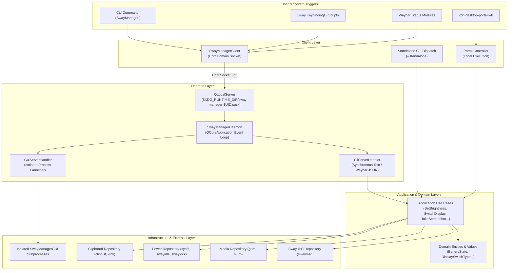
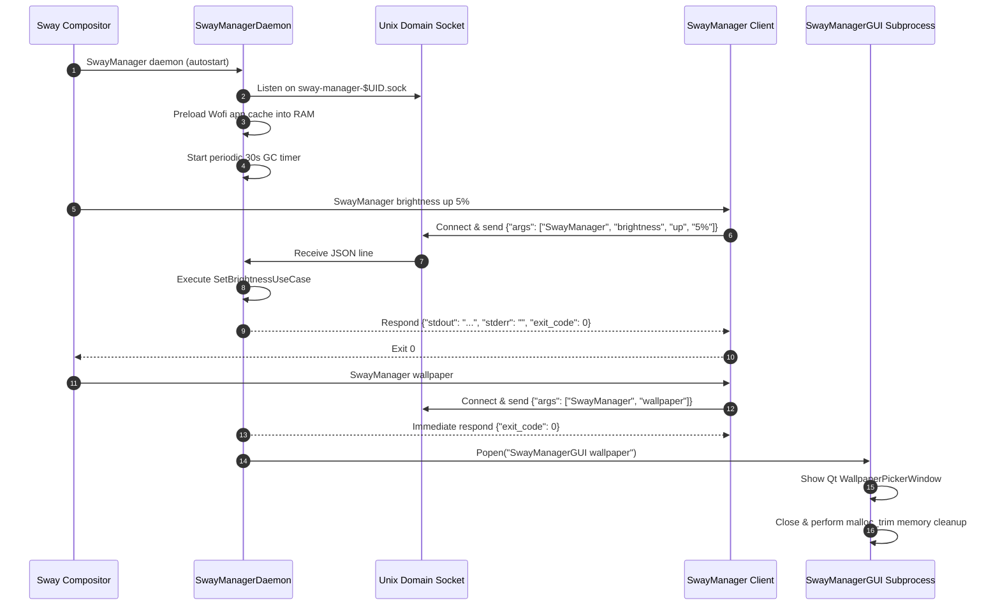

# SwayManager — Architecture Specification

## 1. System Overview

**SwayManager** is a Linux desktop management framework tailored for the **Sway** and **SwayFX** Wayland compositors. It provides unified management of desktop functionality—including screen sharing portals, display layouts, brightness, power profiles, battery conservation, audio volume, clipboard history, app launchers, themes, and screen locking.

The system exposes these capabilities through four distinct interfaces:
1. **Background Daemon Server**: A low-overhead Python/Qt service maintaining shared state and rapid execution.
2. **IPC Client & CLI**: A command-line router capable of dispatching commands to the daemon via Unix Domain Socket or executing standalone.
3. **PySide6 Graphical Interfaces**: Isolated GUI windows, popups, and On-Screen Displays (OSDs) rendered with Qt6.
4. **XDG Desktop Portal Chooser**: A specialized subprocess interface invoked by `xdg-desktop-portal-wlr` for screencast window and output selection.



---

## 2. Layered Architecture (Clean Architecture / DDD-Light)

SwayManager follows Clean Architecture principles organized into four explicit Python package layers under `src/`:

```text
src/
├── domain/         # Enterprise / Business entities, Value Objects, Repository interfaces (ABC)
├── application/    # Orchestrating Application Use Cases
├── infrastructure/ # Technology-specific implementations (Sway, Qt, Sysfs, subprocesses, sockets)
├── presentation/   # Presentation entrypoints (CLI router & PySide6 GUI views)
└── portal/         # Standalone XDG Desktop Portal integration module
```

### Layer Rules & Invariants
1. **Domain (`src/domain/`)**: Contains pure Python dataclasses (`BatteryState`, `IdleState`, `ClipboardItem`, `MenuItem`) and Abstract Base Classes for repositories (`IDisplayRepository`, `IBrightnessRepository`, `IPowerRepository`). It has **zero dependencies** on Qt, Sway, or OS binaries.
2. **Application (`src/application/`)**: Implements single-responsibility use cases (`SetBrightnessUseCase`, `TakeScreenshotUseCase`, `SwitchDisplayModeUseCase`). Use cases depend strictly on domain interfaces (`ABC`), injecting infrastructure repositories at invocation time.
3. **Infrastructure (`src/infrastructure/`)**: Implements domain interfaces using system commands (`swaymsg`, `brightnessctl`, `grim`, `slurp`, `cliphist`), Linux `/sys` files, and PySide6 Qt sockets.
4. **Presentation (`src/presentation/`)**: Parses command-line inputs (`router.py`, `handlers.py`) and constructs Qt user interfaces (`app_factory.py`, windows, OSDs).
5. **Portal (`src/portal/`)**: A specialized module that encapsulates screencast source discovery, custom Qt dialogs, and stdout result formatting for Wayland desktop portals.

---

## 3. Communication & Execution Models

SwayManager operates under three distinct execution models:

### Model A: Client/Server Daemon IPC (Default for CLI & Keybindings)
- The user or Sway keybinding executes `SwayManager <command> [args]`.
- `SwayManagerClient` connects to Unix Domain Socket at `$XDG_RUNTIME_DIR/sway-manager-$UID.sock`.
- The daemon receives the request line over JSON, routes interactive vs synchronous commands:
  - **Synchronous Commands** (e.g., `battery status`, `idle status`, `theme status`): The daemon executes the use case in-process, captures `stdout`/`stderr`, sends the JSON response back over the socket, and the client prints it.
  - **Interactive/GUI Commands** (e.g., `settings`, `wallpaper`, `monitor`, `osd`): The daemon responds immediately to the socket (`exit_code: 0`), then spawns an isolated `SwayManagerGUI` subprocess via `GuiServerHandler`.

### Model B: Standalone Execution (`--standalone` or Direct CLI)
- If `--standalone` is passed, or if the daemon is intentionally bypassed (or for `portal` commands), execution happens entirely within the calling CLI process.
- The use cases and repositories run locally, exiting upon completion.

### Model C: XDG Desktop Portal Chooser Subprocess
- `xdg-desktop-portal-wlr` invokes `SwayManager portal` (or `SwayManagerGUI portal`) as a subprocess when an application requests screen or window sharing.
- `PortalController` queries active outputs via `swaymsg` and windows via `lswt`.
- A Qt selection dialog is presented to the user.
- Upon selection, `PortalResultWriter` outputs the single selection string (e.g., `output:eDP-1` or `window:12345`) to `stdout` and exits cleanly.

---

## 4. System Lifecycle & Process Boundaries



---

## 5. Memory Management & Resiliency Standards

To prevent memory growth in persistent desktop services on Linux:
1. **`QCoreApplication` Daemon Base**: The daemon runs a headless `QCoreApplication` instance without holding a persistent Wayland GUI window surface.
2. **Process Isolation for Windows**: Graphical interfaces (`SwayManagerGUI`) run in disposable subprocesses that terminate completely upon window close, releasing all GPU and Wayland resources back to the kernel.
3. **Explicit Garbage Collection & `malloc_trim`**:
   - Every 30 seconds, `SwayManagerDaemon` triggers `perform_gc()`.
   - `perform_gc()` clears `QPixmapCache`, runs `gc.collect()`, and executes `libc.so.6` `malloc_trim(0)` to yield unallocated heap pages to Linux.
4. **Wayland Display Resilience**:
   - `setup_qt_environment()` forces `QT_QPA_PLATFORM=wayland;xcb` and `QT_WAYLAND_DISABLE_WINDOWDECORATION=1` before initializing any Qt application.
