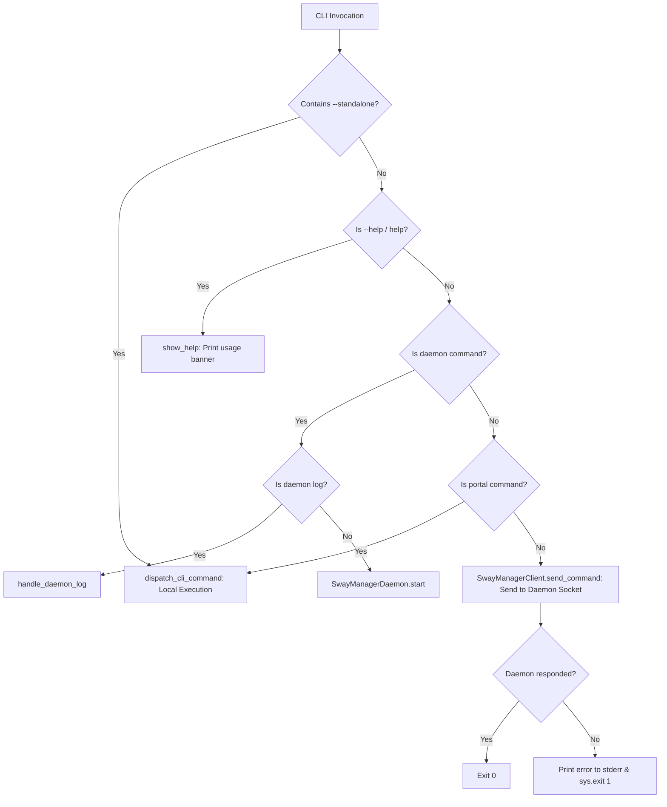

# SwayManager — CLI Specification

## 1. CLI Router & Entrypoint Overview

The command-line interface entrypoint for SwayManager is `src/main.py`, which delegates argument parsing and execution routing to `run_cli()` in `src/presentation/cli/router.py`.

```bash
SwayManager [options] <command> [subcommand] [args...]
```

---

## 2. Command Tree & Routing Invariants

```text
SwayManager
├── --help / -h / help                # Show help banner
├── --standalone <command>            # Force direct local execution (bypass daemon)
├── daemon                            # Start background daemon server
│   └── log / logs / -l [-f]          # View or tail today's daemon log file
├── portal                            # Screen sharing chooser (invoked by xdg-desktop-portal-wlr)
│   ├── status                        # Run diagnostic checks on Wayland & portal stack
│   └── test                          # Run portal chooser in interactive test mode
├── settings / config / config-center # Launch Settings Config Center GUI
├── monitor                           # Launch Monitor Swap GUI
├── wallpaper [directory]             # Launch Wallpaper Picker GUI (optional folder path)
├── osd <brilho|volume> [action]      # Launch OSD overlay popup or window
├── brilho / brightness [up|down|popup]# Adjust display brightness or show popup
├── battery [status|toggle]           # Query Waybar JSON or toggle battery conservation
├── idle [status|toggle]              # Query Waybar JSON or toggle swayidle inhibition
├── theme [status|toggle]             # Query Waybar JSON or toggle GTK dark/light theme
├── power [status|toggle|profile]     # Query Waybar JSON or cycle CPU power profiles
├── screenshot [area|window|full]     # Capture screenshot with grim/slurp
├── menu [category]                   # Launch Wofi app menu (optional category filter)
├── clipboard / clip [action]         # Launch Wofi clipboard history or pin favorites
└── lock                              # Lock screen using swaylock
```

---

## 3. Command Routing Modes



### 3.1 Mode 1: Daemon Subcommand
- Command: `SwayManager daemon`
- Action: Initializes and runs the persistent `SwayManagerDaemon` process on Qt event loop.
- Subcommand `SwayManager daemon log [-f / --follow]`: Reads or tails the log file at `~/.config/sway-manager/logs/log-YYYY-MM-DD.txt`.

### 3.2 Mode 2: Portal Subcommand
- Command: `SwayManager portal [status|test]`
- Action: Bypasses the daemon socket and executes locally (`dispatch_cli_command`). This ensures strict line-protocol compatibility when `xdg-desktop-portal-wlr` invokes SwayManager directly as a subprocess.

### 3.3 Mode 3: Standalone Flag
- Command: `SwayManager --standalone <command>`
- Action: Removes `--standalone` from `sys.argv` and executes `dispatch_cli_command(args)` locally without checking for an active daemon socket.

### 3.4 Mode 4: Daemon Client Protocol (Default)
- Command: Any standard command (`SwayManager battery status`, `SwayManager wallpaper`).
- Action: Attempts to send arguments as JSON over the Unix Domain Socket via `SwayManagerClient.send_command(args)`. If daemon is not running, prints an error message to `stderr` and exits with code `1`.

---

## 4. Subcommand Definitions & Contracts

### 4.1 `battery`
- Usage: `SwayManager battery [status|toggle]`
- `status`: Outputs Waybar JSON to `stdout`:
  ```json
  {"text": "", "class": "conservation-off", "tooltip": "Conservação de Bateria: DESLIGADO (100%)"}
  ```
- `toggle` / empty: Toggles Lenovo IdeaPad conservation mode (80% charge limit) via `/sys/bus/platform/drivers/ideapad_acpi/VPC2004:00/conservation_mode`.

### 4.2 `idle`
- Usage: `SwayManager idle [status|toggle]`
- `status`: Outputs Waybar JSON:
  ```json
  {"text": "", "tooltip": "Suspensão ativada", "class": "idle-on"}
  ```
- `toggle` / empty: Kills or spawns `swayidle`.

### 4.3 `theme`
- Usage: `SwayManager theme [status|toggle]`
- `status`: Outputs Waybar JSON:
  ```json
  {"text": "🌙", "tooltip": "Tema Escuro Ativo", "class": "theme-dark"}
  ```
- `toggle` / empty: Switches GTK and Qt config files between dark and light themes.

### 4.4 `power`
- Usage: `SwayManager power [status|toggle|profile_name]`
- `status`: Outputs Waybar JSON:
  ```json
  {"text": "", "tooltip": "Power Profile: performance"}
  ```
- `toggle` / empty: Cycles power profiles (`power-saver` $\rightarrow$ `balanced` $\rightarrow$ `performance`).

### 4.5 `screenshot`
- Usage: `SwayManager screenshot [full|area|window|-g|-w]`
- Behavior:
  - `full`: Captures all displays using `grim`.
  - `area` / `-g`: Freezes display with `FreezeSelectionOverlay` and captures cropped selection.
  - `window` / `-w`: Captures active window geometry.

### 4.6 `menu`
- Usage: `SwayManager menu [category_filter]`
- Behavior: Parses `.desktop` files in `/usr/share/applications` and launches `wofi --dmenu`.

### 4.7 `clipboard` / `clip`
- Usage: `SwayManager clipboard [action]`
- Behavior: Queries `cliphist list`, presents items in `wofi`, copies selection to Wayland clipboard using `cliphist decode | wl-copy`.

---

## 5. Output Formatting & Standard Streams

1. **`stdout` Cleanliness**:
   - Status commands (`battery status`, `idle status`, `theme status`, `power status`) write **strictly** the single-line JSON payload to `stdout`.
   - Screencast portal commands (`portal`) write **strictly** the single selection string (`output:name` or `window:id`) to `stdout`.
   - Logging and diagnostic logs MUST NEVER be printed to `stdout`.
2. **`stderr` Diagnostics**:
   - Errors, missing binaries, and warnings are printed to `stderr`.
   - Non-zero exit code `1` is set on unhandled CLI or connection errors.
