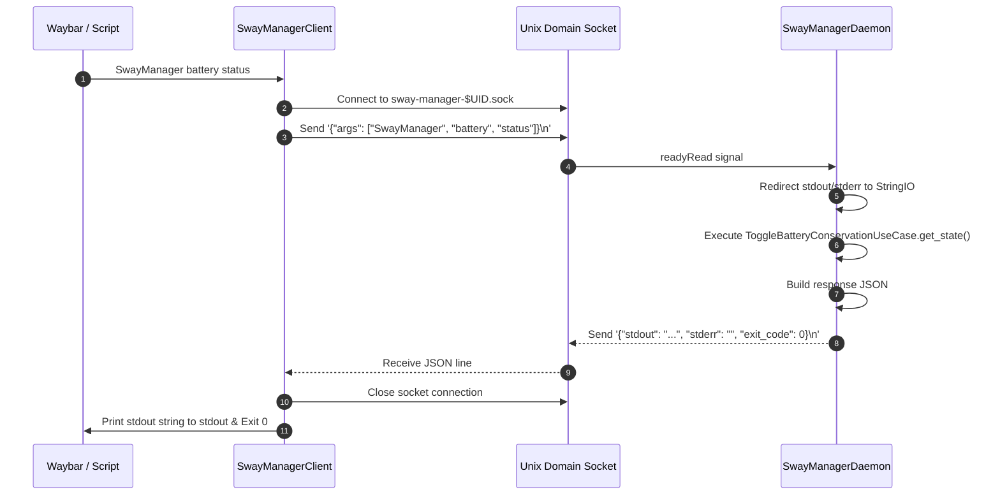
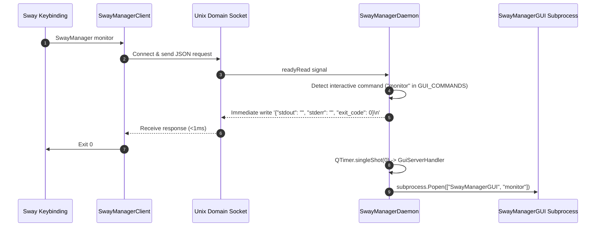

# SwayManager — Client/Server IPC Protocol Specification

## 1. Protocol Overview

The **SwayManager IPC Protocol** enables client processes (such as the `SwayManager` CLI binary, Sway keybindings, or Waybar custom modules) to send execution commands to the persistent background daemon (`SwayManagerDaemon`).

- **Transport**: Unix Domain Socket (SOCK_STREAM).
- **Socket Path**: `$XDG_RUNTIME_DIR/sway-manager-$UID.sock` (fallback: `/tmp/user-$UID/sway-manager-$UID.sock`).
- **Framing**: Single line-delimited JSON text terminated by `\n` in both directions.
- **Encoding**: UTF-8.
- **Default Connection Timeout**: 2.0 seconds.

---

## 2. Socket Discovery & Path Protocol

The socket path resolution function (`get_socket_path()`) follows the XDG Base Directory specification:

```python
def get_socket_path() -> str:
    runtime_dir = os.environ.get("XDG_RUNTIME_DIR")
    if not runtime_dir or not os.path.exists(runtime_dir):
        runtime_dir = f"/tmp/user-{os.getuid()}"
        os.makedirs(runtime_dir, exist_ok=True)
    return os.path.join(runtime_dir, f"sway-manager-{os.getuid()}.sock")
```

---

## 3. Client Request Schema

The client sends a single JSON payload ending with `\n` immediately upon connecting to the socket.

### Request JSON Format
```json
{
  "args": [
    "SwayManager",
    "<command_name>",
    "<subcommand>",
    "<option_1>",
    "<option_2>"
  ]
}
```

### Fields
| Field | Type | Required | Description |
|---|---|---|---|
| `args` | `List[string]` | Yes | Full argument list mirroring `sys.argv`. `args[0]` is the binary name, `args[1]` is the main command name. |

### Example Request Payloads
1. **Waybar Battery Status Check**:
   ```json
   {"args": ["SwayManager", "battery", "status"]}
   ```
2. **Brightness Increase**:
   ```json
   {"args": ["SwayManager", "brightness", "up", "5%"]}
   ```
3. **Open Wallpaper Picker GUI**:
   ```json
   {"args": ["SwayManager", "wallpaper"]}
   ```

---

## 4. Server Response Schema

The daemon processes the line and responds with a single JSON payload ending with `\n`.

### Response JSON Format
```json
{
  "stdout": "<captured_stdout_text>",
  "stderr": "<captured_stderr_text>",
  "exit_code": 0
}
```

### Fields
| Field | Type | Description |
|---|---|---|
| `stdout` | `string` | Text output intended for the caller's standard output (e.g. Waybar JSON). |
| `stderr` | `string` | Error messages or diagnostics intended for standard error. |
| `exit_code` | `integer` | Return status (`0` for success, non-zero for failure). |

### Example Server Responses
1. **Waybar Battery Status Output**:
   ```json
   {
     "stdout": "{\"text\": \"\", \"class\": \"conservation-off\", \"tooltip\": \"Conservação de Bateria: DESLIGADO (100%)\"}\n",
     "stderr": "",
     "exit_code": 0
   }
   ```
2. **Interactive GUI Acknowledgment**:
   ```json
   {
     "stdout": "",
     "stderr": "",
     "exit_code": 0
   }
   ```
3. **Command Error Response**:
   ```json
   {
     "stdout": "",
     "stderr": "Erro ao executar 'battery': Simulated Error\n",
     "exit_code": 1
   }
   ```

---

## 5. Connection Lifecycle & Sequence Flows

### 5.1 Synchronous Status Query Flow (Waybar / Script)



### 5.2 Interactive GUI Dispatch Flow



---

## 6. Error Handling & Timeout Behavior

1. **Daemon Not Running**:
   - `SwayManagerClient.send_command()` checks if the socket file exists. If missing, or if connection raises `FileNotFoundError` / `ConnectionRefusedError`, it returns `False`.
   - The CLI router prints an error to `stderr`:
     `❌ Erro: O SwayManager Daemon não está em execução. Inicie o serviço com 'SwayManager daemon' ou verifique a inicialização do Sway.`
     and exits with code `1`.
2. **Socket Timeout**:
   - Client timeout defaults to `2.0` seconds. If the socket does not return a line within 2.0s, socket operations raise `socket.timeout`, caught by the client, returning `False`.
3. **Malformed JSON Request**:
   - If the daemon reads invalid JSON, it logs the failure to `AsyncLogger` and returns `{"stdout": "", "stderr": "Erro no daemon...", "exit_code": 1}` over the socket before closing.
