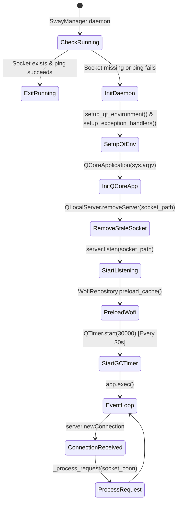

# SwayManager — Daemon Specification

## 1. Overview & Objective

> Implemented in Rust (`daemon/`, binary `sway-manager-daemon`). The Python
> `SwayManagerDaemon`/`AsyncLogger` were removed; the socket protocol and
> behavior below are the contract the Rust port upholds byte-for-byte.

The **SwayManager Daemon** is a persistent background service running in the user's Wayland desktop session. Its primary roles are:
1. Maintaining a persistent runtime to eliminate cold-start overhead when handling CLI commands or Waybar status queries.
2. Listening for incoming commands over a Unix Domain Socket (`$XDG_RUNTIME_DIR/sway-manager-$UID.sock`).
3. Serving synchronous CLI requests (e.g., Waybar status JSON payloads) directly in-process.
4. Launching interactive GUI interfaces in isolated subprocesses (`SwayManagerGUI`) to keep the daemon clean and decoupled from persistent Wayland GUI surfaces.
5. Managing memory through periodic garbage collection and native `malloc_trim` heap trimming.
---

## 2. Initialization & Lifecycle



### 2.1 Single Instance Enforcement
Before starting the event loop, `SwayManagerDaemon.is_daemon_running()` checks if a socket file exists at `get_socket_path()`. If it does, it attempts a non-blocking stream connection with a short timeout. If the socket connects successfully, the daemon assumes an instance is already active, prints `"🚀 SwayManager Daemon já está em execução."`, and exits immediately with code `0`.

### 2.2 Socket Cleanup
If a stale socket file exists from a crashed or unclean previous session (connection fails), the daemon removes the socket file using `os.remove()` and `QLocalServer.removeServer(socket_path)` before calling `self.server.listen(self.socket_path)`.

---

## 3. Request Processing & Dispatching

The socket listener reads line-delimited JSON messages formatted as:
```json
{
  "args": ["SwayManager", "command_name", "subcommand", "options..."]
}
```

```mermaid
flowchart TD
    Req[Incoming Socket Connection] --> ReadLine[socket_conn.readLine]
    ReadLine --> ParseJSON[json.loads raw_data]
    ParseJSON --> ExtractCmd[Extract cmd from args[1]]
    ExtractCmd --> CheckInteractive{Is interactive command?}

    CheckInteractive -- Yes (menu, screenshot, clip, gui...) --> FastResp[Write immediate JSON response: exit_code 0]
    FastResp --> FlushClose[Flush & disconnect socket]
    FlushClose --> SingleShot[QTimer.singleShot: _safe_dispatch_command]

    CheckInteractive -- No (battery status, idle status...) --> RedirBuffers[Redirect stdout & stderr to StringIO]
    RedirBuffers --> ExecDispatch[_safe_dispatch_command]
    ExecDispatch --> BuildResp[Build response JSON: stdout, stderr, exit_code]
    BuildResp --> WriteSocket[Write JSON line to socket]
    WriteSocket --> CloseSocket[Flush & disconnect socket]
```

### 3.1 Synchronous Commands
For commands that report status (such as `battery status`, `idle status`, `theme status`, `power status`), the daemon must return their text or Waybar JSON output to the client.
- The daemon redirects `sys.stdout` and `sys.stderr` using `contextlib.redirect_stdout` and `contextlib.redirect_stderr`.
- It executes `_safe_dispatch_command(args)`.
- It captures the buffer strings and writes a JSON object back to the client socket:
  ```json
  {
    "stdout": "{\"text\": \"\", \"class\": \"conservation-off\", ...}\n",
    "stderr": "",
    "exit_code": 0
  }
  ```
- The connection is flushed and closed.

### 3.2 Interactive / GUI Commands
For interactive commands (e.g. `menu`, `screenshot`, `clipboard`, `settings`, `monitor`, `wallpaper`, `osd`, `lock`), blocking the client connection until user completion would cause timeout errors or block Sway keybindings.
- The daemon writes an immediate JSON response to the socket:
  ```json
  {"stdout": "", "stderr": "", "exit_code": 0}
  ```
- It flushes and closes the socket immediately (elapsed time < 1 ms).
- It schedules execution on Qt's main event loop using `QTimer.singleShot(0, lambda: self._safe_dispatch_command(args))`.

---

## 4. Isolated Process GUI Spawning

GUI commands (e.g., `settings`, `monitor`, `wallpaper`, `osd`, `brightness`) are handled by `GuiServerHandler.handle_gui_command()`.

```python
class GuiServerHandler:
    @staticmethod
    def handle_gui_command(args: List[str], logger=None):
        from infrastructure.daemon.daemon_utils import get_binary_path
        cmd_args = list(args)
        gui_cmd = get_binary_path("SwayManagerGUI")
        exec_cmd = gui_cmd + cmd_args[1:]
        subprocess.Popen(exec_cmd)
```

### Architectural Benefit:
The main daemon process remains a lightweight, headless `QCoreApplication` instance. It never allocates Qt Wayland window surfaces or GPU graphics contexts directly. When a GUI window is requested, a child process running `SwayManagerGUI` is spawned via `subprocess.Popen()`. When the user closes the window, the GUI subprocess exits completely, returning 100% of its graphics memory to Linux.

---

## 5. Memory Management & Garbage Collection

To prevent long-term memory growth in Python's memory allocator and Qt's pixmap cache, `SwayManagerDaemon` implements an automated multi-stage garbage collector triggered every 30 seconds (`self.gc_timer`).

```python
def perform_gc(self):
    try:
        import gc
        import ctypes
        from PySide6.QtGui import QPixmapCache
        
        QPixmapCache.clear()
        gc.collect()
        try:
            ctypes.CDLL("libc.so.6").malloc_trim(0)
        except Exception:
            pass
    except Exception:
        pass
```

### GC Execution Steps:
1. **`QPixmapCache.clear()`**: Purges Qt's global image pixmap cache.
2. **`gc.collect()`**: Forces Python's cyclic garbage collector to reclaim unreachable Python objects.
3. **`malloc_trim(0)`**: Calls glibc's native memory trimming routine to return freed memory pages back to the Linux kernel.
4. **Post-Dispatch GC**: `perform_gc()` is also called immediately in the `finally` block of `_safe_dispatch_command()` after every command completes.

---

## 6. Exception Handling & Resilience

1. **Global Uncaught Exceptions**: `setup_exception_handlers(self.logger)` configures `sys.excepthook` to log uncaught exceptions to `AsyncLogger` without crashing the process loop.
2. **Safe Dispatcher (`_safe_dispatch_command`)**: Wraps all command handlers in `try...except` blocks. If an unhandled exception occurs in a use case, it is logged to `AsyncLogger` and stderr, but the daemon's event loop continues running smoothly.
