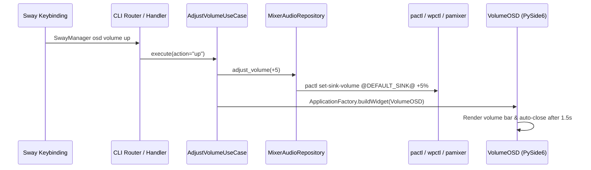

# Domain Spec: Audio Subsystem

## 1. Overview & Responsibilities

The **Audio Domain** manages sound volume level adjustments, output sink muting, and visual feedback via transient On-Screen Display (OSD) popups.

---

## 2. Component Mapping

| Layer | Component | File Path | Responsibility |
|---|---|---|---|
| Domain | `IAudioRepository` | `src/domain/audio/repositories.py` | Abstract interface for volume queries and adjustments |
| Domain | `VolumeLevel` | `src/domain/audio/value_objects.py` | Value object encapsulating integer volume percentage and mute flag |
| Application | `AdjustVolumeUseCase` | `src/application/audio/adjust_volume_use_case.py` | Use case orchestrating volume changes and notifications |
| Infrastructure | `MixerAudioRepository` | `src/infrastructure/audio/mixer_audio_repository.py` | Concrete adapter wrapping `pactl`, `wpctl`, or `pamixer` |
| Presentation | `VolumeOSD` | `src/presentation/gui/osd/volume_osd.py` | PySide6 transient OSD popup window |

---

## 3. Interfaces & Contracts

### CLI Triggers
```bash
SwayManager osd volume [action]
```

### Supported Actions:
- `up` / `increase`: Increases master volume by 5%.
- `down` / `decrease`: Decreases master volume by 5%.
- `mute` / `toggle-mute`: Toggles sink mute state.

---

## 4. Execution & Flow



---

## 5. Failure Modes & Edge Cases

| Condition | System Behavior | Mitigation |
|---|---|---|
| `pactl`/`wpctl` missing | Command catches `FileNotFoundError` | Falls back gracefully, prints warning to stderr |
| Volume exceeds 100% | Clamped by repository / mixer | Safe ceiling limit enforced |
| Headless execution | OSD creation skipped if Qt display unavailable | Safe fallback to CLI text output |
