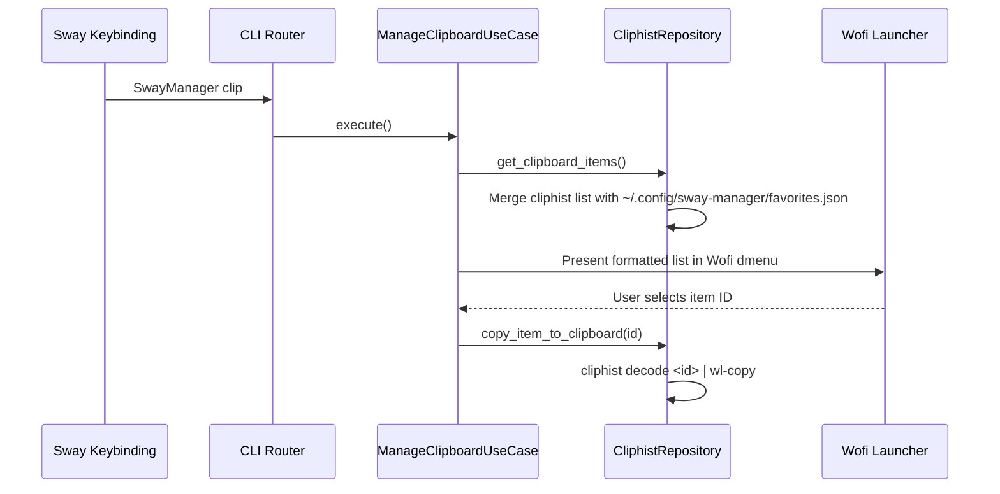

# Domain Spec: Clipboard Subsystem

## 1. Overview & Responsibilities

The **Clipboard Domain** provides Wayland clipboard history management, item preview, favorite entries pinning/unpinning, and clear operations using `cliphist` and `wofi`.

---

## 2. Component Mapping

| Layer | Component | File Path | Responsibility |
|---|---|---|---|
| Domain | `ClipboardItem` | `src/domain/clipboard/entities.py` | Data entity holding ID, text preview, image flag, and favorite status |
| Domain | `IClipboardRepository` | `src/domain/clipboard/repositories.py` | Abstract interface for listing, copying, and pinning items |
| Application | `ManageClipboardUseCase` | `src/application/clipboard/manage_clipboard_use_case.py` | Orchestrates history parsing, menu display, favorite actions |
| Infrastructure | `CliphistRepository` | `src/infrastructure/clipboard/cliphist_repository.py` | Wrapper around `cliphist` binary & `~/.config/sway-manager/favorites.json` |

---

## 3. Interfaces & Contracts

### CLI Triggers
```bash
SwayManager clipboard [action]
SwayManager clip [action]
```

### Supported Actions:
- `select` / empty: Displays `wofi` menu with history and pinned items. Decoding selection writes to `wl-copy`.
- `clear`: Clears `cliphist` history store.
- `manage_favorites`: Opens management interface for pinned items.

---

## 4. Execution & Data Flow



---

## 5. Persistence File (`favorites.json`)

Pinned favorite clipboard entries are persisted at `~/.config/sway-manager/favorites.json`:
```json
[
  {
    "id": "fav-1",
    "text": "Frequent SSH Key snippet",
    "raw_preview": "1\tFrequent SSH Key snippet",
    "is_favorite": true
  }
]
```
