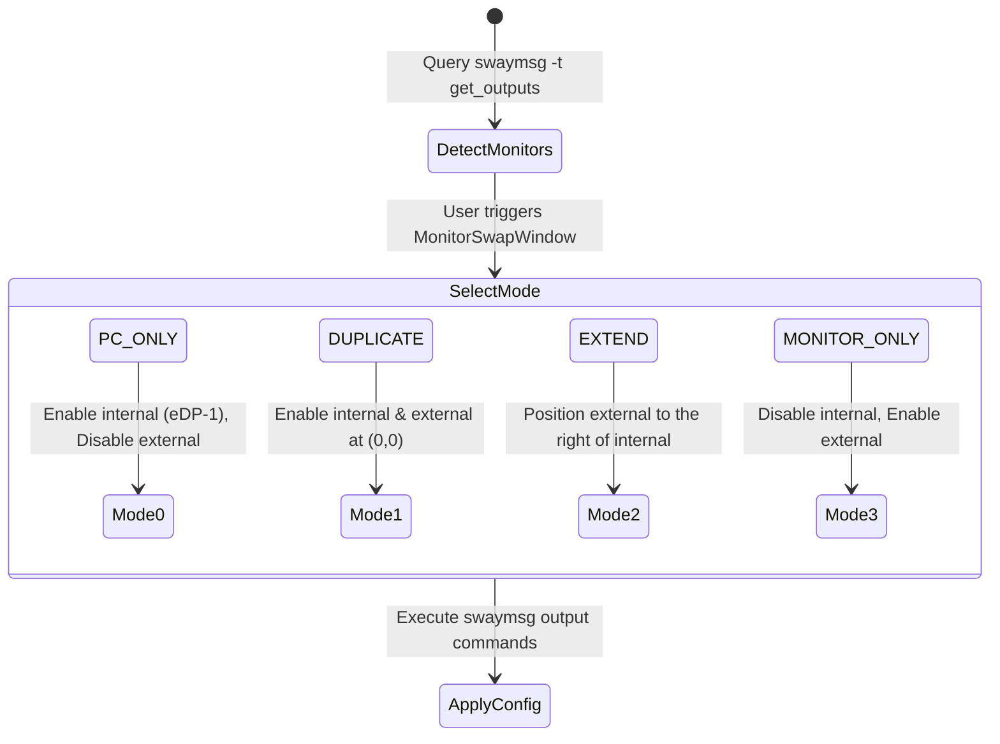

# Domain Spec: Display & Brightness Subsystem

## 1. Overview & Responsibilities

The **Display Domain** manages multi-monitor layouts (PC Only, Duplicate, Extend, Monitor Only) via Sway IPC, as well as screen backlight brightness adjustments via `brightnessctl`.

---

## 2. Component Mapping

| Layer | Component | File Path | Responsibility |
|---|---|---|---|
| Domain | `MonitoresSway`, `DisplaySwitchType` | `src/domain/display/entities.py` | Display entities and mode enum |
| Domain | `IDisplayRepository`, `IBrightnessRepository` | `src/domain/display/repositories.py` | Interfaces for monitor query/config and brightness control |
| Application | `SwitchDisplayModeUseCase`, `SetBrightnessUseCase` | `src/application/display/` | Display mode switching and brightness calculation use cases |
| Infrastructure | `SwayDisplayRepository` | `src/infrastructure/display/sway_display_repository.py` | `swaymsg` output layout switcher |
| Infrastructure | `BrightnessctlRepository` | `src/infrastructure/display/brightnessctl_repository.py` | `brightnessctl` binary wrapper |
| Presentation | `MonitorSwapWindow` | `src/presentation/gui/windows/monitor_swap.py` | Display layout selector window |
| Presentation | `BrightnessPopup`, `BrightnessOSD` | `src/presentation/gui/windows/` & `osd/` | Brightness popup slider and HUD OSD |

---

## 3. Display Switching Logic (`DisplaySwitchType`)



---

## 4. Interfaces & Contracts

### CLI Triggers
```bash
SwayManager monitor
SwayManager brilho [up|down|popup|<percentage>]
SwayManager brightness [up|down|popup|<percentage>]
```

### Sway Output Command Invariants:
- PC Only: `swaymsg output <internal> enable; swaymsg output <external> disable`
- Extend: `swaymsg output <internal> enable pos 0 0; swaymsg output <external> enable pos <w> 0`
- Monitor Only: `swaymsg output <internal> disable; swaymsg output <external> enable pos 0 0`
