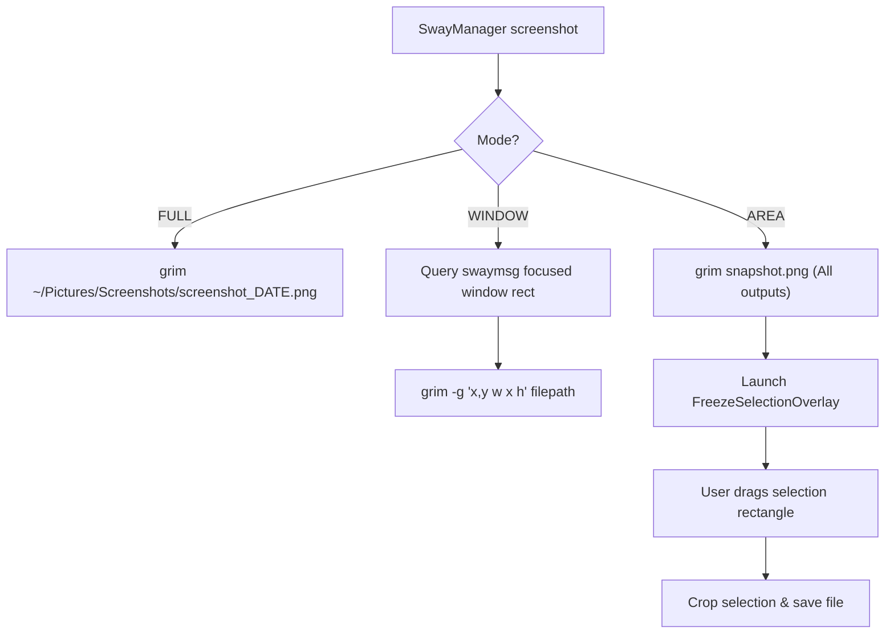

# Domain Spec: Media & Screenshots Subsystem

## 1. Overview & Responsibilities

The **Media Domain** handles screenshot capture under Wayland, supporting full-screen, active window, and interactive area crop selection across single and multi-monitor setups with HiDPI display scaling.

---

## 2. Component Mapping

| Layer | Component | File Path | Responsibility |
|---|---|---|---|
| Domain | `ScreenshotMode` | `src/domain/media/value_objects.py` | Enum: `FULL`, `AREA`, `WINDOW` |
| Domain | `IScreenshotRepository` | `src/domain/media/repositories.py` | Abstract interface for capturing screenshots |
| Application | `TakeScreenshotUseCase` | `src/application/media/take_screenshot_use_case.py` | Executes screenshot use case and saves to destination folder |
| Infrastructure | `GrimSlurpScreenshotRepository` | `src/infrastructure/media/grim_slurp_screenshot_repository.py` | Captures images using `grim` and `slurp` |
| Presentation | `FreezeSelectionOverlay` | `src/presentation/gui/widgets/freeze_selection_overlay.py` | PySide6 full-screen freeze overlay for interactive area cropping |

---

## 3. Screenshot Modes & Flow

---

## 4. HiDPI & Multi-Monitor Coordinate Resolution

When capturing an area with `FreezeSelectionOverlay`:
1. `SwayDisplayRepository.get_outputs()` queries physical monitor geometries and HiDPI scale factors (`scale: 1.0, 1.25, 2.0`).
2. Displays are combined into a composite canvas preserving screen gaps and physical pixel density.
3. The selection rectangle drawn in logical Qt coordinates is mapped to native physical display pixels before cropping, ensuring high-definition images without blurriness.

---

## 5. Storage Directory

Screenshots are saved by default to:
`~/Pictures/Screenshots/screenshot_YYYY-MM-DD_HH:MM:SS.png`
(Configurable in `~/.config/sway-manager/config.json`).
