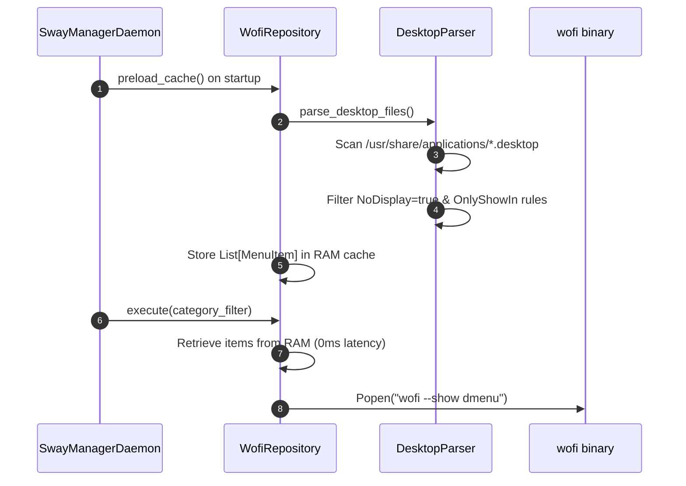

# Domain Spec: Menu & App Launcher Subsystem

## 1. Overview & Responsibilities

The **Menu Domain** parses Linux desktop application entries (`.desktop` files), resolves icon assets, caches application lists in RAM, and launches application menus via `wofi`.

---

## 2. Component Mapping

| Layer | Component | File Path | Responsibility |
|---|---|---|---|
| Domain | `MenuItem` | `src/domain/menu/entities.py` | Entity representing desktop app (name, exec command, icon, category) |
| Domain | `IMenuRepository` | `src/domain/menu/repositories.py` | Abstract interface for loading and launching application menus |
| Application | `ShowMenuUseCase` | `src/application/menu/show_menu_use_case.py` | Filters items by category and launches Wofi launcher |
| Infrastructure | `DesktopParser` | `src/infrastructure/menu/desktop_parser.py` | Scans `/usr/share/applications` and parses `.desktop` INI files |
| Infrastructure | `IconResolver` | `src/infrastructure/menu/icon_resolver.py` | Maps XDG icon names to image icon files |
| Infrastructure | `WofiRepository` | `src/infrastructure/menu/wofi_launcher.py` | Interacts with `wofi` and maintains in-memory RAM cache |

---

## 3. Parsing & Preloading Architecture

---

## 4. Invariants & Performance Enhancements

1. **In-Memory RAM Caching**: On daemon startup, `WofiRepository.preload_cache()` parses all system desktop files once. Subsequent menu invocations read from RAM, delivering sub-millisecond menu launch times.
2. **Cache Invalidation / Reload**:
   `SwayManager daemon reload-cache` triggers re-parsing of `/usr/share/applications` without restarting the daemon.
3. **Desktop Entry Filtering**:
   Ignores hidden entries (`NoDisplay=true`, `Hidden=true`) and non-Sway environment rules (`OnlyShowIn=KDE;GNOME;`).
