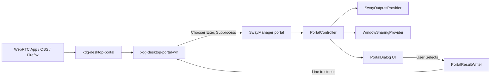

# SwayManager — XDG Desktop Portal Specification

## 1. Overview & Objective

The **Portal Subsystem** (`src/portal/`) integrates SwayManager with the **XDG Desktop Portal** framework (`xdg-desktop-portal-wlr` / `xdg-desktop-portal`). It serves as the interactive chooser program when WebRTC browsers (Chrome, Firefox), Discord, OBS Studio, or Zoom request screen or window sharing under Wayland.



---

## 2. Screencast Chooser Contract (`stdout` Protocol)

`xdg-desktop-portal-wlr` executes `SwayManager portal` (configured in
`~/.config/xdg-desktop-portal-wlr/config`). The chooser MUST write exactly the
same source label that the backend supplied on standard input:

1. **xdg-desktop-portal-wlr 0.7.x** supplies bare output names:
   ```text
   HDMI-A-3
   ```
2. **Newer dmenu protocols** can supply structured source labels:
   ```text
   Monitor: eDP-1
   Window: Firefox (abc123)
   ```
3. **User cancellation** writes nothing to `stdout` and exits with status
   code `0`.

Preserving the raw label is required because the backend performs an
exact-string comparison when resolving the selected source.
---

## 3. Strict Standard Output (`stdout`) Invariant

**CRITICAL CONTRACT**: `PortalResultWriter` (`src/portal/result_writer.py`) is the **ONLY** component in the entire codebase allowed to write to `sys.stdout` when executing portal commands.

- All logging, debug messages, warnings, and stack traces MUST be directed to `sys.stderr` or `AsyncLogger`.
- Any stray print statement or debug output to `stdout` corrupts the line protocol, causing `xdg-desktop-portal-wlr` to fail screen sharing sessions.

```python
class PortalResultWriter:
    def __init__(self, out: TextIO = sys.stdout) -> None:
        self._out = out

    def write_result(self, result: PortalResult) -> None:
        line = str(result)
        if not line:
            return
        self._out.write(line + "\n")
        self._out.flush()
```

---

## 4. Component Breakdown

### 4.1 `PortalController` (`src/portal/controller.py`)
Orchestrates screencast source discovery, dmenu stdin mode parsing, Qt dialog display, and result writing.
- **`run()`**: Queries monitors via `SwayOutputsProvider` and windows via `WindowSharingProvider`. If sources exist, presents `PortalDialog`. Returns `PortalResult` or `None`.
- **Dmenu Mode Support**: `xdg-desktop-portal-wlr` v0.8.x may pipe source labels into stdin. `_maybe_read_dmenu_stdin()` parses stdin lines to match selected raw labels.

### 4.2 `SwayOutputsProvider` (`src/portal/outputs_provider.py`)
Queries `swaymsg -t get_outputs` to find active displays. Converts output objects into `PortalSource(id=output_name, source_type=PortalSourceType.MONITOR)`.

### 4.3 `WindowSharingProvider` (`src/portal/windows_provider.py`)
Uses `lswt -c` to inspect open Wayland windows. Checks if Sway version is compatible ($\ge 1.8$ or SwayFX). Converts foreign toplevel window handles into `PortalSource(id=window_id, source_type=PortalSourceType.WINDOW)`.

### 4.4 `PortalDialog` (`src/presentation/gui/portal/dialog.py`)
PySide6 dialog presenting tabbed cards for displays and windows. Supports keyboard activation (Enter/Space), Escape to cancel, dark theme styling, and empty state warnings when window sharing prerequisites (`lswt`) are missing.

### 4.5 `PortalDiagnostics` (`src/portal/diagnostics.py`)
Invoked via `SwayManager portal status`. Checks:
- Wayland session environment (`$WAYLAND_DISPLAY`, `$XDG_CURRENT_DESKTOP`).
- Sway compositor version.
- PipeWire availability.
- Active systemd services (`xdg-desktop-portal`, `xdg-desktop-portal-wlr`).
- `lswt` utility presence.

### 4.6 `PortalConfigInstaller` (`src/portal/config_installer.py`)
Invoked by `install.sh`. Configures:
- `~/.config/xdg-desktop-portal/portals.conf`:
  ```ini
  [preferred]
  default=wlr;gtk;
  org.freedesktop.impl.portal.Screencast=wlr
  ```
- `~/.config/xdg-desktop-portal-wlr/config`:
  ```ini
  [screencast]
  chooser_cmd=/home/user/.config/sway/bin/sway-manager portal
  chooser_type=simple
  ```

---

## 5. Testing & Diagnostics Commands

- Run diagnostics: `SwayManager portal status`
- Test chooser dialog interactively: `SwayManager portal test`
