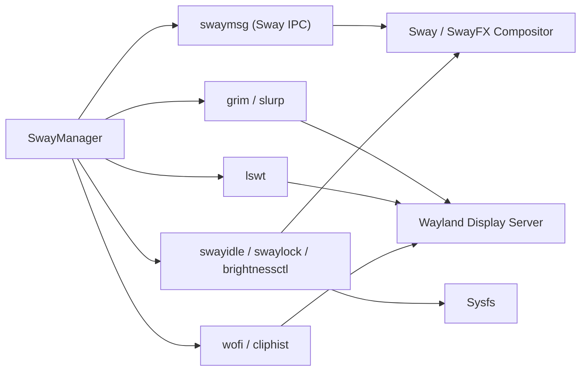

# SwayManager — Sway & Wayland Integration Specification

## 1. Overview & Integration Architecture

**SwayManager** is explicitly designed for the **Sway** and **SwayFX** Wayland compositors. It interacts with the compositor and Wayland environment through three main channels:
1. Direct binary execution of `swaymsg` for IPC commands and state queries.
2. Direct execution of native Wayland utilities (`grim`, `slurp`, `lswt`, `wofi`, `cliphist`, `swaylock`, `swayidle`, `brightnessctl`, `pactl`/`wpctl`/`pamixer`).
3. Reading/writing Sway configuration directives in `~/.config/sway/config`.



---

## 2. Sway IPC Commands (`swaymsg`) Catalog

SwayManager issues structural `swaymsg` commands formatted as JSON or CLI strings.

### 2.1 Monitor & Display Management (`SwayDisplayRepository`)
- **Query Outputs**: `swaymsg -t get_outputs`
  - Returns JSON array of output objects containing `name`, `active`, `current_mode`, `rect`, `scale`, `focused`.
- **Configure Outputs**:
  - Enable monitor: `swaymsg output <name> enable`
  - Disable monitor: `swaymsg output <name> disable`
  - Set position: `swaymsg output <name> pos <x> <y>`
  - Set scale: `swaymsg output <name> scale <scale>`
- **Reload Sway Config**: `swaymsg reload`

### 2.2 Wallpaper Management (`SwayWallpaperRepository`)
- **Set Wallpaper**: `swaymsg output * bg "<filepath>" fill`

### 2.3 Version & Capability Parsing (`WindowSharingProvider`)
- **Query Version**: `swaymsg -t get_version`
  - Returns JSON object: `{"human_readable": "sway version 1.9", "variant": "swayfx"}`.
  - SwayManager checks if `variant == "swayfx"` or version $\ge 1.8$ to determine feature availability.

---

## 3. External Wayland Utilities Integration

SwayManager wraps external Wayland utilities into concrete infrastructure repositories:

| Subsystem | Utility | Binary Invocation | Repository Class |
|---|---|---|---|
| Screenshots | `grim` | `grim -g "<x>,<y> <w>x<h>" <file>` | `GrimSlurpScreenshotRepository` |
| Area Selection | `slurp` | `slurp -f "%x %y %w %h"` | `GrimSlurpScreenshotRepository` |
| Window Listing | `lswt` | `lswt -c` | `WindowSharingProvider` |
| App Launcher | `wofi` | `wofi --show dmenu` | `WofiRepository` |
| Clipboard | `cliphist` | `cliphist list` / `cliphist decode` | `CliphistRepository` |
| Brightness | `brightnessctl` | `brightnessctl g` / `brightnessctl s <val>%` | `BrightnessctlRepository` |
| Screen Lock | `swaylock` | `swaylock -f -i <wallpaper>` | `SwayLockRepository` |
| Idle Management | `swayidle` | `swayidle -w timeout <sec> 'swaylock'` | `SwayIdleRepository` |
| Audio Mixer | `pactl` / `wpctl` | `pactl set-sink-volume` / `wpctl set-volume` | `MixerAudioRepository` |

---

## 4. Subprocess Execution & Error Handling Standards

1. **Subprocess Invocations**: Use standard library `subprocess.run()` or `subprocess.Popen()` with explicit timeouts where applicable.
2. **Standard Output Parsing**: Always capture `stdout=subprocess.PIPE, stderr=subprocess.PIPE, text=True, check=True`.
3. **Graceful Fallback on Missing Binaries**:
   - If an external utility is missing (`FileNotFoundError` or exit code $\ne 0$), infrastructure repositories catch the exception and return empty sets, default fallbacks, or raise domain-specific `SwayException` subclasses.
   - Example: If `lswt` is missing, window sharing provider degrades gracefully to output-only screen sharing without crashing.

---

## 5. Sway Configuration Integration (`~/.config/sway/config`)

`PortalConfigInstaller` (`src/portal/config_installer.py`) manages session environment variables required by Wayland desktop portals inside Sway's config file:

```text
exec systemctl --user import-environment WAYLAND_DISPLAY XDG_CURRENT_DESKTOP
exec dbus-update-activation-environment --systemd WAYLAND_DISPLAY XDG_CURRENT_DESKTOP=sway
```

### Installation Method:
`PortalConfigInstaller._ensure_sway_session_env()` inspects `~/.config/sway/config`. If these `exec` statements are absent, it appends them automatically and backs up the original config file.
